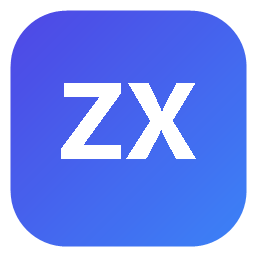

<div align="center">



# ZXDesk 工作台

**装在自己设备上的私有化数据工作台** —— 数据落在你自己的 NAS 里，每个账号一份、互不可见

[](https://github.com/XWJ-z/ZXDesk/releases/latest)
[](https://github.com/XWJ-z/ZXDesk/releases)
[](LICENSE)
[](#%E6%94%AF%E6%8C%81%E7%9A%84%E7%AB%AF)

</div>

---

## 下载

点下面的按钮直接拿最新版安装包（都是当前 Release 里的文件，发新版会自动指向新包）：

<div align="center">

<a href="https://github.com/XWJ-z/ZXDesk/releases/latest/download/zxdesk.fpk"></a>

<br>

<a href="https://github.com/XWJ-z/ZXDesk/releases/latest/download/zxdesk-android.apk"></a>

<br>

<a href="https://github.com/XWJ-z/ZXDesk/releases/latest/download/zxdesk-windows-setup.exe"></a>

<br>

<a href="https://github.com/XWJ-z/ZXDesk/releases/latest/download/zxdesk-edge.zip"></a>

</div>

> 全部历史版本、每个包对应的更新说明 → **[Releases](https://github.com/XWJ-z/ZXDesk/releases)**

## 这是什么

ZXDesk 把散在各处的东西收进一套界面：任务、日程、课表、记账、资产、密码、收藏、设备台账、团队协作与 AI 助手。

- **不需要注册任何云端账号**，也不依赖第三方云服务；
- **断网可用**（AI 功能除外，它用你自填的 API Key）；
- **多端同一份数据**：手机 App、电脑浏览器、Windows 桌面端、浏览器扩展，连的都是同一台 NAS。

## 功能

| 模块 | 能做什么 |
| --- | --- |
| 任务与随手记 | 四象限、项目任务与甘特图、限时任务、周期打卡、闪念一键变任务 |
| 番茄钟与日程表 | 专注计时与统计、大学课表（教务模板导入、调课停课、跨周调课）、行程与车票 |
| 网址与密码 | 收藏夹（一条地址都不外发）、密码库（主密码派生密钥、密文落库、闲置自动上锁） |
| 个人资产 | 资产分组台账、生活记账（多账户 / 分类预算 / 转账 / 净值曲线 / 三方账单导入）、数码设备台账与寿命推算 |
| 团队协作 | 共享项目、任务分配、附件、评论、活动流水、成员一对一私聊 |
| AI 辅助任务 | 自填 API Key，按模块授权读数据；写操作只能提议，点确认才落库 |

首页看板把今天的待办、课程、逾期与提醒收在一屏，区间条可在今日 / 单日 / 本周 / 本月之间切换，也能整屏切成日历视图。

## 支持的端

| 端 | 怎么装 | 状态 |
| --- | --- | --- |
| **fnOS** | 下 `zxdesk.fpk`，应用中心「手动安装」或 `appcenter-cli install-fpk zxdesk.fpk`；也可在应用中心搜「ZXDesk 工作台」 | 已上架 |
| **Android** | 下 `zxdesk-android.apk` 侧载，连你自己的 NAS | 一期完成 |
| **Windows** | 下 `zxdesk-windows-setup.exe` 安装，连你自己的 NAS | 正式版 |
| **Edge** | 下 `zxdesk-edge.zip`，解压后 `edge://extensions` → 开发人员模式 → 加载解压缩的扩展 | 可用 |
| HarmonyOS | — | 规划中 |

服务端只跑在 fnOS 上。其余三端是「外壳 ＋ 远程加载界面」，业务与界面始终从 NAS 拉取 —— 所以工作台升级后，壳不用跟着重发。

## 从源码运行

**fnOS** —— 需要 Node.js 24。

```bash
cd zxdesk/app/core
node server.js          # 数据落在 zxdesk/var，端口 8990
```

自己打包需要飞牛官方 [fnpack](https://developer.fnnas.com/docs/cli/fnpack/)：

```bash
fnpack build --directory zxdesk     # 产物 zxdesk.fpk
```

**Android** —— 需要 JDK 17 ＋ Android SDK 35。

```bash
cd android
./gradlew :app:assembleDebug        # 产物 app/build/outputs/apk/debug/app-debug.apk
```

**Windows** —— 需要 Node.js 22＋。

```bash
cd windows
npm install
npm run dist                        # 出安装包与绿色包
```

**Edge** —— 无需构建，直接加载 `edge/` 目录即可。

## 怎么做的

- **零依赖**：服务端只用 Node 原生能力，装在 NAS 上不需要 `npm install`，升级不用处理依赖树。
- **两种存储后端**：SQLite（默认）与 JSON 文件，同一套业务接口 —— 环境里没有 SQLite 也能跑。
- **没有构建步骤**：浏览器直接加载 ES Module，改完刷新即生效。

## 许可证

本仓库有**两份**许可证，管的事情不同：

| 文件 | 管什么 |
| --- | --- |
| `LICENSE`（根目录） | **源代码**（MIT）：可自由使用、修改、分发本仓库的代码 |
| `zxdesk/LICENSE` | **成品包**（最终用户许可协议）：适用于上面下载的那个 `.fpk`，写明数据归属、备份风险与唯一的联网点 |

就源代码及其衍生作品而言，两份不一致时以根目录的开源许可证为准。

## 链接

- 项目官网：<https://zxdesk.xwjznh.cn>
- 问题反馈：本仓库的 Issues，或项目官网的反馈入口
